  

  

  
  
  

## About me

- LLM Engineer at [Qure.ai](https://www.qure.ai/), working on agentic AI and agent infrastructure
- CSE, IIT Indore
- Previously: [Foundation Industries](https://www.foundation-industries.com/) · [Metzev](https://www.metzev.com/) · [unstudio.ai](https://www.unstudio.ai/) · [Styldod](https://www.styldod.com/)
- Interests: agents, applied ML, MLOps, backend, performance work
- Off-screen: gym, anime, finding new rabbit holes

## Tools I use

   
   
  

  
  
  
  
  
  
  

## GitHub stats

  
  

  

  <picture>
    <source media="(prefers-color-scheme: dark)" srcset="https://raw.githubusercontent.com/TheNetherWatcher/TheNetherWatcher/output/snake-dark.svg"/>
    <source media="(prefers-color-scheme: light)" srcset="https://raw.githubusercontent.com/TheNetherWatcher/TheNetherWatcher/output/snake.svg"/>
    
  </picture>

  

